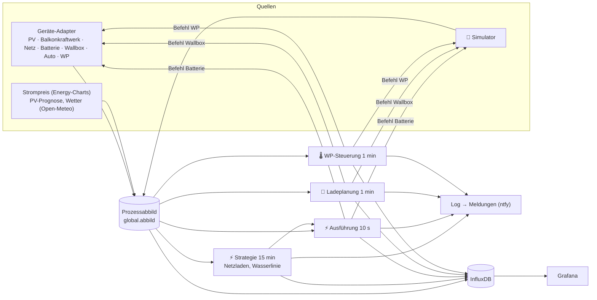

# Radler-EMS

Energiemanagement für ein Haus mit **PV-Anlage mit Wechselrichter, PV-Batterie, Wallbox fürs E-Auto und
Wärmepumpe**, optional einem **Balkonkraftwerk**, auf einem Raspberry Pi mit **Node-RED, InfluxDB 2 und Grafana**.

Abgeleitet aus dem Haus-EMS (zwei Hausakkus, Balkonkraftwerk, Waterkotte, Etrel), vereinfacht auf vier Geräte
und **geräteunabhängig**: Jedes Gerät hängt über einen Adapter an einer festen Schnittstelle. Solange die echten
Geräte fehlen, bildet ein **Simulator** sie nach. Das ganze EMS läuft also sofort und lässt sich ausprobieren.
Beim Hackathon tauscht man nur noch Adapter gegen echte Geräte.



## Was das EMS tut

| Regel | kurz | Doku |
|---|---|---|
| **Netzladen (Vorschau)** | Lädt den Akku aus dem Netz nur, wenn ihm vor der nächsten billigeren Stunde Energie für Stunden fehlt, die nach Verlusten und Aufschlag teurer sind als jetzt | [EMS](docs/ems.md#netzladen-vorschau) |
| **Wasserlinie** | Dieselbe Energie in den Akku, aber aus der Mittagsspitze: weniger Einspeisespitze, weniger Stunden bei 100 % | [EMS](docs/ems.md#wasserlinie-spitzenkappung) |
| **Auto lädt aus dem Netz, nicht aus dem Akku** | Beim Autoladen entlädt der Akku nicht ins Auto; bei teurem Strom oder PV-Laden deckt er nur das Haus | [EMS](docs/ems.md#ausführung-alle-10-s) |
| **Ladeplanung Auto** | bis 25 % sofort, 50 % sicher zur Abfahrt, bis 80 % in günstigen Stunden, darüber frei; PV-Laden mit dem Überschuss nach dem Hausakku | [Wallbox](docs/wallbox.md) |
| **Wärmepumpe** | SG-Ready 3 bzw. +2 K bei PV-Überschuss oder in den billigsten Stunden, nie mitten im Heizlauf zurück | [Wärmepumpe](docs/waermepumpe.md) |
| **Log und Meldungen** | ein Log je Tag, Fehler/Warnungen in InfluxDB, Push über ntfy mit Sperrzeit und Nachtruhe, Tagesbericht um 7 Uhr | [Architektur](docs/architektur.md#log-und-meldungen) |

Ziele in dieser Rangfolge (aus Haus-EMS übernommen): **1. feste Zusagen** (Auto 25/50 %, Heizlauf nicht
abbrechen, Akku-Grenzen), **2. Kosten**, **3. bei kleinem Kostenunterschied schonend und netzdienlich**.

## Schnellstart

Auf einem Raspberry Pi (64-bit Raspberry Pi OS, getestet: Pi 4, Debian 13):

```bash
git clone https://github.com/<konto>/Radler-EMS.git ~/radler-ems
bash ~/radler-ems/deploy/setup-basis.sh          # InfluxDB 2, Grafana, Node-RED (fragt einmal das sudo-Passwort)
bash ~/radler-ems/deploy/nodered_einrichten.sh   # Logger, secrets.env, Log-Verzeichnis
nano ~/radler-ems/secrets.env                    # Standort, PV-Flächen, Akku …
bash ~/radler-ems/deploy/influx_einrichten.sh    # Buckets, Task, Tokens
sudo systemctl restart nodered
python3 ~/radler-ems/tools/flows_einspielen.py
python3 ~/radler-ems/tools/grafana_einspielen.py
```

Danach: Node-RED `http://<pi>:1880`, Grafana `http://<pi>:3000` (Ordner „Radler-EMS“). Zugangsdaten stehen nach
`setup-basis.sh` in `~/zugangsdaten-smarthome.txt`. Ausführlich: [Betrieb](docs/betrieb.md).

## Dokumentation

| Seite | Inhalt |
|---|---|
| [Architektur](docs/architektur.md) | Schichten, Prozessabbild, Tabs, Vorzeichen, Log und Meldungen |
| [EMS](docs/ems.md) | Strategie (Netzladen, Wasserlinie), Ausführung, Sicherheitsnetz |
| [Wallbox](docs/wallbox.md) | Ladeplanung und PV-Laden |
| [Wärmepumpe](docs/waermepumpe.md) | Anhebung, SG-Ready, Warmwasser |
| [Geräte-Adapter](docs/geraete-adapter.md) | **die Schnittstelle zum Anbinden echter Geräte**, Checkliste je Gerät |
| [Simulator](docs/simulator.md) | Modell und Grenzen |
| [Einstellungen](docs/einstellungen.md) | alle Variablen in `secrets.env` |
| [InfluxDB und Grafana](docs/influxdb-grafana.md) | Buckets, Messreihen, Tokens, Dashboards |
| [Betrieb](docs/betrieb.md) | Installation, Einspielen, Sicherung, Updates, Übergabe des Pi |
| [Hackathon](docs/hackathon.md) | Ablauf, Aufgaben, Ideen |

## Im Repository

| Pfad | Inhalt |
|---|---|
| `nodered/funktionen/*.js` | Code aller Funktionsknoten (hier ändern, nie in `flows.json`) |
| `nodered/build.py` → `nodered/flows.json` | Generator: Tabs, Gruppen, Verbindungen |
| `grafana/build_dashboards.py` → `grafana/dashboards/` | Dashboards |
| `influxdb/` | Tasks (Verdichtung auf 15 min) |
| `deploy/` | Installation, Einrichtung, Vorlage `secrets.env.example`, Logger für `settings.js` |
| `tools/` | Flows und Dashboards einspielen |
| `tests/` | Tests der Regellogik: `node --test tests/` |

Nicht im Repository: `secrets.env`, `flows_cred.json`, Logs, Sicherungen (siehe `.gitignore`).

## Entwicklung

```bash
python3 nodered/build.py              # flows.json neu bauen
python3 grafana/build_dashboards.py   # Dashboards neu bauen
node --test tests/                    # Tests (Node.js ≥ 18)
```

Strompreise: Energy-Charts (Fraunhofer ISE), Daten Bundesnetzagentur/SMARD, CC BY 4.0.
Wetter und Einstrahlung: Open-Meteo, CC BY 4.0.
