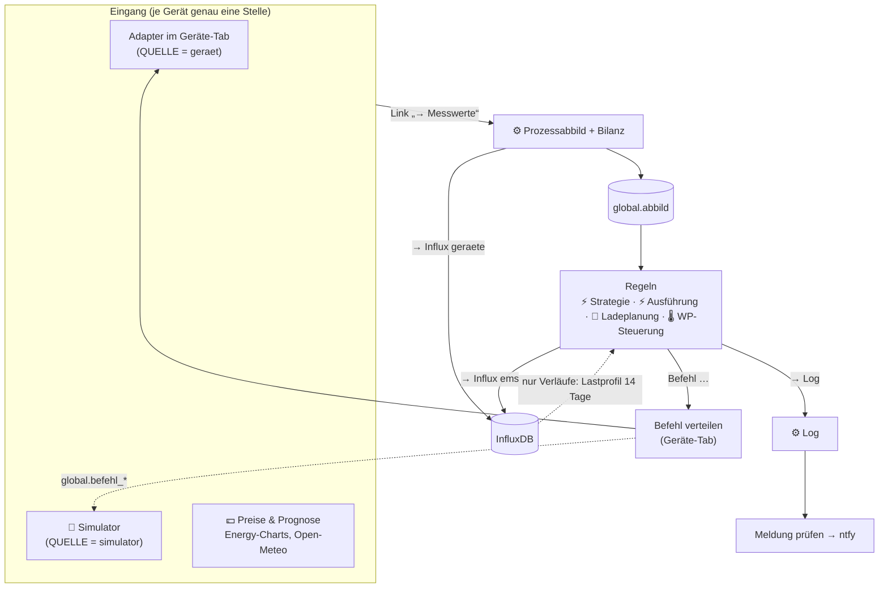

# Architektur

## Schichten



Die Regeln wissen nicht, welches Gerät dahinter steckt. Sie lesen einheitliche Signale aus dem Prozessabbild und
geben einheitliche Befehle. Der Adapter übersetzt in beide Richtungen ([Geräte-Adapter](geraete-adapter.md)).

## Tabs

| Tab | Gruppen | Takt |
|---|---|---|
| ⚙️ System | Start, Messwerte → Prozessabbild, InfluxDB schreiben, Logeintrag erzeugen, Geräte-Wächter, Tagesbericht | – |
| ⚡ EMS | Lastprofil, Strategie, Ausführung | 1 h, 15 min, 10 s |
| ☀️ PV & Netz | Adapter PV-Wechselrichter, Adapter Balkonkraftwerk, Adapter Netzzähler | 10 s |
| 🔋 PV-Batterie | Befehl Batterie, Adapter Batterie | 10 s |
| 🚗 Auto | Ladeplanung (mit Befehl), Adapter Wallbox, Adapter Auto-Ladestand, Ladestand von Hand | 1 min |
| 🌡️ Wärmepumpe | Steuerung (mit Befehl), Adapter Wärmepumpe | 1 min |
| 💶 Preise & Prognose | Strompreise, PV-Prognose, Wetter | 15 min, 30 min, 10 min |
| 🧪 Simulator | Simulator | 10 s |

Jede Gruppe hat oben einen Kommentar, jeder Funktionsknoten einen Kopf mit Zweck, Eingang, Ausgängen, Kontext und
Umgebungsvariablen. Tabs verbinden sich nur über Link-Knoten.

## Prozessabbild

`global.abbild` ist ein Objekt mit einem Eintrag je Signal:

```js
abbild['batterie.soc_pct'] = { wert: 54.2, einheit: '%', zeit: 1795600000000, quelle: 'simulator' }
```

Die Endung des Feldnamens ist die Einheit (`_W`, `_Wh`, `_pct`, `_C`, `_K`, `_A`). Ein Wert, der älter ist als die
Grenze des Lesers, gilt als fehlend. Die Regel verhält sich dann so, wie ihr Kopfkommentar es beschreibt
(z. B. Fail-Safe in der Ausführung, „teuerste Stunden“ in der Ladeplanung).

| Signal | Vorzeichen / Werte | Quelle |
|---|---|---|
| `pv.leistung_W` | ≥ 0 | Adapter PV |
| `bkw.leistung_W` (optional `bkw.soc_pct`) | ≥ 0, AC-Abgabe des Balkonkraftwerks | Adapter Balkonkraftwerk (nur mit `BKW_QUELLE` ≠ aus) |
| `netz.bezug_W` | **> 0 Bezug, < 0 Einspeisung** | Adapter Netz |
| `batterie.soc_pct`, `batterie.leistung_W` | leistung **> 0 Entladen, < 0 Laden** | Adapter Batterie |
| `wallbox.leistung_W`, `wallbox.status`, `wallbox.ampere` | status `getrennt`, `angesteckt`, `laedt`, `pausiert`, `stoerung` | Adapter Wallbox |
| `auto.soc_pct` | 0–100 | Adapter Auto oder von Hand (`/radler/auto?soc=`) |
| `wp.leistung_W`, `wp.status`, `wp.aussen_C`, `wp.raum_C`, `wp.ww_C` | status `aus`, `heizen`, `warmwasser`, `stoerung` | Adapter WP |
| `haus.verbrauch_W`, `haus.ohne_auto_W`, `haus.grundlast_W` | Bilanz: Netz + PV + Balkonkraftwerk + Batterie (− Auto, − WP) | Prozessabbild, bei jedem Netzwert |
| `markt.preise`, `markt.preise_15`, `markt.preis_jetzt_ct` | Endpreis in ct/kWh (Börse + `ABGABEN_CT`) | Strompreise |
| `prognose.pv`, `prognose.pv_anlage`, `prognose.bkw` | `[{ t, W }]` je Stunde (t = Beginn); `pv` = Anlage + Balkonkraftwerk (gekappt auf `BKW_MAX_W`) | PV-Prognose |
| `wetter.temperatur_C` … | | Wetter |
| `befehl.batterie`, `befehl.wallbox`, `befehl.wp` | letzter Befehl (zur Anzeige) | Befehl verteilen |

Ansehen: im Node-RED-Editor rechts „Kontextdaten“ → Global → `abbild` (aktualisieren).

Weitere globale Werte, die Regeln einander geben:

| Schlüssel | von | für |
|---|---|---|
| `ems_lastprofil` | Lastprofil | Strategie |
| `ems_nl`, `ems_wl` | Strategie | Ausführung |
| `ems_plan` (Preise, PV 12 h), `ems_haus` (teuer) | Strategie | Ladeplanung, WP-Steuerung, Ausführung |
| `ems_live` (Überschuss Ø 5 min) | Ausführung | WP-Steuerung, Strategie (Tageskorrektur) |
| `ems_ueberschuss` (fürs Auto, Ø 1 min) | Ausführung | Ladeplanung |
| `wallbox_plan` | Ladeplanung | Ausführung (PV-Laden) |
| `befehl_batterie`, `befehl_wallbox`, `befehl_wp` | Befehl verteilen | Simulator |

Das Abbild liegt nur im Arbeitsspeicher. Nach einem Neustart ist es nach etwa 10 s (Geräte) bzw. 5 s (Preise,
Prognose: erster Abruf 30–35 s nach dem Start, weil Netz und DNS nach dem Booten etwas brauchen) wieder gefüllt; die Strategie läuft erst nach 60 s.

## Modi

Jede Regel hat einen Modus (`secrets.env`): `aus`, `beobachten` (rechnen, protokollieren, nichts senden), `aktiv`.
Neue Regeln und neu angebundene Geräte laufen zuerst einige Tage in `beobachten`, dann wird umgeschaltet.

## Log und Meldungen

**Ein Log** (aus Haus-EMS, Anforderung R2): Alle Tabs schicken Ereignisse an den Link „→ Log“ mit
`msg.log = { stufe, bereich, text, daten?, melden? }`.

- Datei je Tag: `~/radler-ems/log/radler-ems-JJJJ-MM-TT.log`, eine JSON-Zeile je Eintrag, 30 Tage aufbewahrt.
- `fehler` und `warnung` zusätzlich in InfluxDB (`ems`/`ems_log`, Grafana „Entscheidungen“).
- `info` nur für **geänderte** Entscheidungen, Neustart, Gerät wieder online. Läufe ohne Änderung stehen in den
  Protokoll-Messreihen (`ems_strategie`, `ems_ausfuehrung`, `wallbox_plan`, `wp_steuerung`).
- Warnungen und Fehler aller Knoten (`node.warn`, `node.error`, HTTP-/InfluxDB-Fehler) kommen über den Logger in
  `settings.js` dazu (`deploy/settings-radler.js`).

**Meldungen** entstehen nur aus Logeinträgen mit `melden` („Meldung prüfen“):

| Art | Beispiel | Sperrzeit | nachts (22–7 Uhr) |
|---|---|---|---|
| `zusage` | Zusage in Gefahr: Auto lädt nicht, obwohl es muss | 60 min | ja |
| `geraet` | Gerät liefert seit 15 min keine Werte / wieder online | 60 min | ja |
| `befehl` | Gerät lehnt Befehl ab | 60 min | nein |
| `konfig` | Einstellungen fehlen | 6 h | nein |
| `wallbox` | Laden gestartet, pausiert, beendet (mit kWh) | – | ja |
| `tagesbericht` | Tagesbericht um 7 Uhr | – | ja |
| `sonst` | alles andere | 60 min | nein |

Zahlen im Text zählen bei der Sperrzeit nicht als Unterschied. Nachts zurückgehaltene Meldungen stehen im
Tagesbericht. Versand über [ntfy](https://ntfy.sh) (`NTFY_TOPIC`), ohne Thema nur ins Log.

**Tagesbericht** um 7 Uhr: Stromkosten (Bezug × Viertelstundenpreis − Einspeisung × `EINSPEISE_CT`), Bezug,
Einspeisung, PV, Auto, Stunden Netzladen.

## Sicherheitsnetz

- **Timeout am Gerät:** Jeder Adapter soll das Gerät so ansteuern, dass es ohne neuen Befehl nach wenigen Minuten in
  den Normalbetrieb fällt (die Ausführung sendet alle 60 s, Wallbox und WP alle 15 min erneut). Der Simulator macht
  das nach 5 min.
- **Fail-Safe:** Fehlen Netz- oder Batteriewerte, sendet die Ausführung „eigenverbrauch“ und schreibt einen Fehler.
- **Geräte-Wächter:** meldet Geräte ohne Werte nach `GERAET_OFFLINE_MIN` (15 min).
- **Ohne Preise** lädt das Auto frei, Netzladen und günstige WP-Fenster entfallen.
