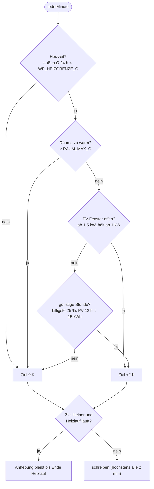

# Wärmepumpe: Anhebung bei PV-Überschuss und günstigem Strom

Tab „🌡️ Wärmepumpe“, Gruppe „Steuerung“ (`wp_steuerung.js`), jede Minute. Einziger Schreiber an die Wärmepumpe.
Übernommen aus Haus-EMS (Waterkotte), geräteunabhängig gemacht.

**Idee:** Ein Haus mit Fußbodenheizung speichert Wärme sehr lange (in Haus-EMS gemessen: ohne Heizlauf nur etwa
0,02 K Abkühlung je Stunde, wirksame Wärmekapazität 45–80 kWh/K). Wer in Sonnen- oder billigen Stunden etwas mehr
heizt, heizt später entsprechend weniger, ohne dass es spürbar kälter wird. In Haus-EMS war das der größte Hebel der
Hausregelung (≈ 75 € im Jahr mit PV-Überschuss).

## Befehl

```js
{ sgready: 2 | 3, anhebung_K: 0 … 2, ww_absenken: true | false, grund }
```

Der Adapter nimmt, was die Wärmepumpe kann:

| Wärmepumpe kann | Umsetzung |
|---|---|
| **SG-Ready** (zwei Kontakte, z. B. über ein Relais/Shelly) | `sgready` 3 = Einschaltempfehlung (mehr heizen, oft auch Warmwasser höher), 2 = Normalbetrieb |
| **Sollwertverschiebung** über Modbus/HTTP | `anhebung_K` auf den Heizkurven- oder Raumsollwert |
| **Warmwasser-Sollwert** schreibbar | bei `ww_absenken` den Sollwert z. B. 5 K senken |

SG-Ready 1 (Sperre) und 4 (Anlaufbefehl) nutzt die Steuerung nicht.

## Regel



| Anlass | Anhebung | Bedingung |
|---|---|---|
| PV-Überschuss | `ANHEBUNG_PV_K` (2) | Überschuss ≥ `PV_START_W`. Überschuss = Einspeisung − Akku-Entladung + Strom der WP, alles Ø 5 min; ab `PV_AKKU_SOC` zählt auch die Ladung des Akkus. Das Fenster endet, wenn der Überschuss `PV_AUS_MIN` (20 min) unter `PV_HALTEN_W` liegt, frühestens nach 30 min und **nie in einem Heizlauf** |
| günstiger Strom | `ANHEBUNG_GUENSTIG_K` (2) | die laufende Stunde gehört zu den billigsten `WP_GUENSTIG_ANTEIL` (25 %) der bekannten Stunden, und die PV-Prognose der nächsten 12 h ist < `WP_PV_PROGNOSE_WH` |
| Warmwasser eben fertig | `NACHHEIZ_K` (0,5) für `NACHHEIZ_MIN` (3) | Heizlauf direkt anhängen, spart einen Kompressorstart |
| Räume zu warm | 0 | `wp.raum_C` ≥ `RAUM_MAX_C`, zurück ab 0,3 K darunter (ohne Raumwert gilt „nicht zu warm“) |
| keine Heizzeit | 0 | Außentemperatur Ø 24 h ≥ `WP_HEIZGRENZE_C` (aus `wp.aussen_C`, sonst Wetter) |

**Warum der Strom der WP zum Überschuss zählt, Akku-Strom aber nicht:** Startet die WP von selbst, würde sie sonst
ihren eigenen Strom als fehlenden Überschuss sehen bzw. (in der ersten Haus-EMS-Fassung) Akku-Strom als Überschuss:
nachts +2 K aus dem Akku.

**Warum Fenster statt Schwelle:** Bei schwankendem Überschuss ging die Anhebung in Haus-EMS anfangs viermal in 4 h
hoch und runter, Läufe brachen ab. Als Fenster bleibt sie oben, solange die Energie billig ist, und endet nie mitten
in einem Lauf (sonst läge der Rücklauf schlagartig über dem neuen Soll und der Lauf bräche ab).

**Warmwasser absenken** (`ww_absenken`): nachts von `WW_NACHT_VON` bis `WW_NACHT_BIS` (1–5 Uhr), während einer
Anhebung ab 1 K (die Wärme soll in den Estrich) und während eines Heizlaufs (sonst unterbricht die WP den Heizlauf für
Warmwasser). Nur wirksam, wenn der Adapter einen Warmwasser-Sollwert schreiben kann.

## Neustart und Ausfall

Viele Wärmepumpen behalten einen geschriebenen Sollwert, bis jemand ihn ändert. Fällt Node-RED während einer Anhebung
aus, bleibt +2 K stehen. Deshalb im Adapter, wenn möglich, einen Timeout am Gerät nutzen; bei SG-Ready über ein
Relais ein Relais mit Rückfall (z. B. Shelly mit „Auto off“ nach 20 min, alle 15 min neu gesetzt).

## Protokoll `wp_steuerung`

`anhebung_K`, `ziel_K`, `sgready`, `grund`, `heizzeit`, `pv_fenster`, `guenstig`, `heizen`, `ww_absenken`,
`ueberschuss_W`, `raum_C`, `aussen24_C`, `gesendet`.
